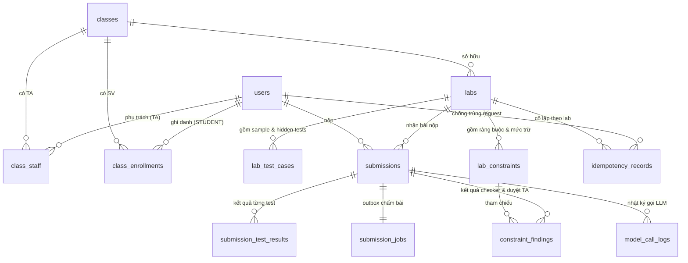

# Đánh giá & Kế hoạch Chuẩn hóa Database (`feat/auth_and_labs`) — LeeTKOB

> **Cập nhật đồng bộ Checker & Proposal (2026-11-28):** Schema khởi tạo trong `gateway/migrations/0001_init_pa3_schema.up.sql` & `.down.sql` đã được mở rộng lên **16 bảng chuẩn hóa** theo kế hoạch đã duyệt tại [database-checker-sync-plan.md](database-checker-sync-plan.md) (Phương án 1: bổ sung `lab_constraint_revisions`, `grade_appeals`, sửa `model_call_logs.request_id` cho `TIMEOUT`/`PROVIDER_ERROR`, lưu `checker_model`/`prompt_version`/`checked_at` & `manual_score_*`, thêm `studentIdentifiers` trong `SubmissionJob`, và tách `rebalanceLabPassSample`).

> **Phạm vi đánh giá:** Toàn bộ tầng lưu trữ PostgreSQL, cấu hình môi trường, Docker Compose, cơ chế migration/seed và hợp đồng dữ liệu trên nhánh `origin/feat/auth_and_labs` (tính tới commit `7bdeeca`), đối chiếu trực tiếp với [AGENTS.md](../AGENTS.md), [engineering-rules.md](engineering-rules.md) (Sessions 03–08), [PA3_rubric.md](rubric/PA3_rubric.md), [FAQ.md](proposal/FAQ.md), [proposal-detail.md](proposal/proposal-detail.md), [post-submissions.md](contract/post-submissions.md), [checker-output.md](contract/checker-output.md) và [web-ui-plan.md](web-ui-plan.md).

---

## 1. Đánh giá Hiện trạng Database trên nhánh `feat/auth_and_labs`

### 1.1. Những điểm đã làm tốt (Giữ lại & Phát huy)

1. **Kiến trúc Dual-Mode (`PostgresPersistence` + In-Memory Store cho Unit Test):**
   Khi chạy Jest (`JEST_WORKER_ID`), hệ thống dùng kho dữ liệu trong bộ nhớ giúp `npm run test` chạy 100% offline không cần Docker hay kết nối mạng, tuân thủ quy định Offline Gate trong [AGENTS.md](../AGENTS.md).
2. **Giao dịch nguyên tử kết hợp Outbox bước đầu (`createSubmissionAtomic`):**
   Đã gom bước hủy cờ `is_counting` cũ, chèn `submissions`, chèn `submission_jobs` (Transactional Outbox) và ghi `idempotency_records` vào cùng một transaction `BEGIN ... COMMIT/ROLLBACK`.
3. **Bảo mật mật khẩu & cấu hình container Postgres cơ bản:**
   Mật khẩu được băm bằng `crypto.scryptSync` + so sánh hằng thời gian `timingSafeEqual`; `docker-compose.yml` đã ghim phiên bản `postgres:16.4-alpine` (không dùng `:latest`), chỉ mở cổng vào `127.0.0.1`, và có `pg_isready` healthcheck.

---

### 1.2. Các vấn đề về Cấu hình, Migration, Docker & Vận hành (Chưa đạt chuẩn)

| Mức độ | Vấn đề phát hiện trên `feat/auth_and_labs` | Quy định bị vi phạm | Hệ quả thực tế |
| :-: | :--- | :--- | :--- |
| **P0** | **`docker-compose.yml` trỏ tới `gateway/Dockerfile` không tồn tại & `.dockerignore` chặn nhầm `checker`, `web/src`** | [PA3_rubric.md](rubric/PA3_rubric.md) (Crit 5 — `docker compose up --build`), [engineering-rules.md](engineering-rules.md) §6 | Chạy `docker compose up --build` thất bại ngay lập tức vì thiếu `gateway/Dockerfile`; `.dockerignore` ở gốc chặn mất mã nguồn khi build toàn stack. |
| **P0** | **Tự động chạy DDL (`CREATE TABLE IF NOT EXISTS`) và tự động seed 5 tài khoản mật khẩu yếu (`admin123`, `ta123`) ngay trong `onModuleInit()` mỗi khi app khởi động** | [AGENTS.md](../AGENTS.md) §3, [engineering-rules.md](engineering-rules.md) §2 & §6 (*Separate Migrations*, cặp `.up.sql`/`.down.sql`, `lock_timeout = '2s'`) | Vi phạm nguyên tắc không chạy migration trong `npm start`; chèn tài khoản demo mật khẩu yếu vào môi trường production; mỗi lần khởi động `DEMO_USERS` lại băm salt ngẫu nhiên mới không tất định. |
| **P0** | **Không fail-loudly khi thiếu cấu hình DB ở môi trường chạy thật & thiếu giới hạn `pg.Pool`** | [AGENTS.md](../AGENTS.md) §3, [engineering-rules.md](engineering-rules.md) §1 (*Validate config once at startup*) | Khi chạy thực tế (`NODE_ENV=production`) mà quên đặt `DATABASE_URL`, `Gateway` không báo lỗi mà âm thầm rơi về lưu trữ RAM (`Map`), mất sạch dữ liệu khi container khởi động lại. `Pool` chưa có `max`, `connectionTimeoutMillis`, `idleTimeoutMillis`, `statement_timeout`. |
| **P1** | **Endpoint `/health` chưa kiểm tra kết nối PostgreSQL thật** | [engineering-rules.md](engineering-rules.md) §6 (*Honest HEALTHCHECK*) | `GET /health` luôn trả `200 { status: "ok" }` kể cả khi Postgres đã ngắt kết nối hoặc sai mật khẩu. |
| **P1** | **Biến môi trường `.env.example` còn dư `MONGODB_URI=`** | [AGENTS.md](../AGENTS.md) §1 & §3 | Dự án chỉ dùng PostgreSQL 16 + Redis 7 + RabbitMQ 3; để lại `MONGODB_URI` gây lệch giữa tài liệu cấu hình và kiến trúc thực tế. |
| **P1** | **Test Postgres (`persistence-and-queue.spec.ts`) chỉ khớp chuỗi SQL trên mock giả lập** | [engineering-rules.md](engineering-rules.md) §5 (*Contract / Integration tests against real DB*) | Mock chỉ kiểm tra `text.includes('INSERT INTO ...')`, không phát hiện được lỗi cú pháp SQL, lỗi kiểu dữ liệu, hay vi phạm khóa ngoại/unique thực tế trên PostgreSQL 16. |

---

### 1.3. Các lỗ hổng trong Thiết kế Schema (`gateway/src/persistence/schema.ts`)

1. **[P0 — Vi phạm cốt lõi Session 04] Hoàn toàn không có `FOREIGN KEY` và `CHECK` constraint trên cả 6 bảng:**
   - Mọi cột liên kết (`class_id`, `lab_id`, `student_id`, `submission_id`) đều là `TEXT` rời rạc, không có `REFERENCES` -> DB chấp nhận bài nộp trỏ tới `lab_id` hoặc `student_id` không tồn tại.
   - Không có `CHECK` cho `role`, `status`, `deadline > opened_at`, giới hạn CPU `1..5s`, RAM `64..512 MB` (`FAQ-05`), dung lượng code `<= 65536 bytes`, hay mức trừ điểm.
2. **[P0 — Race Condition làm vỡ bất biến `is_counting` (`FAQ-04`)]:**
   - Trong `createSubmissionAtomic()`, khóa tư vấn `pg_advisory_xact_lock` đang băm theo `${studentId}:${idempotencyKey}` thay vì `${labId}:${studentId}`, đồng thời bảng `submissions` **thiếu Partial Unique Index `WHERE is_counting = TRUE`**.
   - Hệ quả: nếu cùng một sinh viên gửi 2 request nộp bài gần như đồng thời (với 2 `Idempotency-Key` khác nhau), cả 2 transaction đều đi qua khóa tư vấn, cùng chạy `UPDATE` rồi cùng `INSERT ... is_counting = TRUE`, tạo ra **2 bài nộp cùng được tính điểm cho 1 sinh viên trên 1 bài lab**!
3. **[P0 — Khóa chính `idempotency_records` thiếu `lab_id`]:**
   - Hiện đặt `PRIMARY KEY (student_id, key)` (không có `lab_id`). Nếu client dùng key ở lab khác hoặc khi ghi đè key hết hạn (`ON CONFLICT (student_id, key) DO UPDATE SET lab_id = EXCLUDED.lab_id`), bản ghi của lab trước bị chạm chéo biên giới lab (trái nguyên tắc cô lập `(student, lab)` tại [AGENTS.md](../AGENTS.md) §4.2).
4. **[P0 — Thiếu bảng `classes` & `class_staff`, mô hình phân lớp bất đối xứng]:**
   - Chưa có bảng `classes` lưu thông tin lớp (`code`, `name`, `term`). Quyền lớp của TA đang nhét tạm vào mảng `users.class_ids JSONB` trong khi sinh viên lại dùng bảng `class_memberships` (và `class_memberships` cũng thiếu `UNIQUE (class_id, student_id)`).
5. **[P0 — Thiếu toàn bộ cột và bảng lưu kết quả Judge (`N1–N3`) & Checker / Hàng chờ Review của TA (`D2`, `K1–K3`)]:**
   - **Bảng `labs`:** Thiếu `opened_at`, `cpu_time_limit_sec`, `memory_limit_mb`, `published_at TIMESTAMPTZ` (`FAQ-05`, `FAQ-13` cần mốc giờ công bố để tính hạn phúc khảo 48h). Hàm `buildSubmissionJob()` đang bỏ qua cấu hình của lab và dùng cứng `DEFAULT_SUBMISSION_LIMITS`. Ngoài ra, nhét `test_cases JSONB` (có thể chứa test lớn hàng trăm KB) trực tiếp vào bảng `labs` làm phình mọi câu truy vấn danh sách lab.
   - **Bảng `submissions`:** Vẫn giữ kiểu `SubmissionStatus` chứa `'WRONGFUL_DEDUCTION'` (vốn là chỉ số offline eval); hoàn toàn chưa có cột lưu kết quả từ `judge/` (`overall_verdict`: `AC/WA/TLE/MLE/RE/CE`, `compile_output`, `passed_tests`, `total_tests`, `max_time_ms`, `max_memory_kb`, `judged_at`) và chưa có bảng `submission_test_results` cho verdict từng test (`FAQ-02`).
   - **Hoàn toàn thiếu bảng cho `checker/` & TA Review Queue ([checker-output.md](contract/checker-output.md)):**
     - Chưa có bảng `constraint_findings` để lưu kết quả theo từng ràng buộc (`source`, `verdict`, 7 mã `unsure_reason` theo `FAQ-09`, `evidence` số dòng gốc, cờ `is_sampled_pass` cho mẫu 10% `pass` theo `FAQ-10`, trạng thái duyệt `PENDING_REVIEW`, quyết định của TA).
     - Chưa có bảng `model_call_logs` để lưu `request_id` thật từ Gemini API, lượng token, độ trễ và kiểm soát hạn mức quota theo từng bài lab (`PA#3 Criterion 4`).
6. **[P1 — Outbox `submission_jobs` chưa hỗ trợ worker cạnh tranh an toàn & phục hồi khi crash]:**
   - Thiếu cột `locked_by`, `locked_at`, `available_at`, `max_attempts`, `last_error` để các worker dùng `SELECT ... FOR UPDATE SKIP LOCKED` và tự thu hồi job bị treo khi container chấm gặp sự cố.
7. **[P1 — Thiếu toàn bộ Index truy vấn & Quy ước lưu điểm số nguyên (Session 04 & 05)]:**
   - Chưa có bất kỳ `CREATE INDEX` nào phục vụ phân trang cursor (`(created_at DESC, id DESC)`), lọc bài nộp theo sinh viên/lab, lọc hàng chờ TA hay quét job outbox.
   - Mức điểm và khoản trừ nên được lưu dưới dạng **số nguyên đơn vị nhỏ nhất** (`centipoints`, ví dụ `1000 = 10.00 điểm`, `250 = 2.50 điểm`) theo đúng [engineering-rules.md](engineering-rules.md) §2 thay vì số thực dấu phẩy động.

---

## 2. Kế hoạch Chỉnh sửa & Bổ sung Chi tiết

### 2.1. Thiết kế Schema PostgreSQL 16 Chuẩn hóa (12 bảng)

Thiết kế dưới đây giải quyết triệt để nhu cầu của **PA#3** (`D1`, `D2`, `N1–N3`, `K1–K3`) đồng thời giữ sẵn điểm nối sạch (không phải phá hay đổi tên cột cũ) cho **PA#4** (TA duyệt/ghi đè, Công bố điểm, Audit Log) và **PA#5** (Phúc khảo 48h):

#### Đặc tả từng bảng và ràng buộc toàn vẹn (`NOT NULL`, `CHECK`, `UNIQUE`, `FK`):

1. **`users`**
   - Cột: `id TEXT PRIMARY KEY`, `username TEXT NOT NULL UNIQUE`, `email TEXT NOT NULL UNIQUE`, `display_name TEXT NOT NULL`, `password_hash TEXT NOT NULL`, `role TEXT NOT NULL CHECK (role IN ('STUDENT', 'TA', 'ADMIN'))`, `is_active BOOLEAN NOT NULL DEFAULT TRUE`, `created_at TIMESTAMPTZ NOT NULL DEFAULT NOW()`.
   - *Thay đổi so với cũ:* Bỏ cột phi chuẩn `class_ids JSONB`; thêm `email` và `display_name` để khớp cả contract backend lẫn giao diện `web/`.
2. **`classes`**
   - Cột: `id TEXT PRIMARY KEY`, `code TEXT NOT NULL UNIQUE` (ví dụ `CSC10002-24CLC1`), `name TEXT NOT NULL`, `term TEXT NOT NULL`, `created_by TEXT REFERENCES users(id) ON DELETE RESTRICT`, `created_at TIMESTAMPTZ NOT NULL DEFAULT NOW()`.
3. **`class_staff`** *(Gán TA vào lớp)*
   - Cột: `class_id TEXT NOT NULL REFERENCES classes(id) ON DELETE CASCADE`, `ta_id TEXT NOT NULL REFERENCES users(id) ON DELETE CASCADE`, `assigned_at TIMESTAMPTZ NOT NULL DEFAULT NOW()`, `PRIMARY KEY (class_id, ta_id)`.
4. **`class_enrollments`** *(Chuẩn hóa từ `class_memberships`)*
   - Cột: `id TEXT PRIMARY KEY`, `class_id TEXT NOT NULL REFERENCES classes(id) ON DELETE CASCADE`, `student_id TEXT NOT NULL REFERENCES users(id) ON DELETE CASCADE`, `status TEXT NOT NULL CHECK (status IN ('ACTIVE', 'DROPPED'))`, `enrolled_at TIMESTAMPTZ NOT NULL DEFAULT NOW()`, **`UNIQUE (class_id, student_id)`**.
5. **`labs`**
   - Cột:
     - `id TEXT PRIMARY KEY`, `class_id TEXT NOT NULL REFERENCES classes(id) ON DELETE RESTRICT`
     - `title TEXT NOT NULL CHECK (btrim(title) <> '')`, `statement TEXT NOT NULL DEFAULT ''`
     - `opened_at TIMESTAMPTZ NOT NULL DEFAULT NOW()`, `deadline TIMESTAMPTZ NOT NULL`
     - `cpu_time_limit_sec INTEGER NOT NULL DEFAULT 1 CHECK (cpu_time_limit_sec BETWEEN 1 AND 5)` (`FAQ-05`)
     - `memory_limit_mb INTEGER NOT NULL DEFAULT 256 CHECK (memory_limit_mb BETWEEN 64 AND 512)` (`FAQ-05`)
     - `max_payload_bytes INTEGER NOT NULL DEFAULT 65536 CHECK (max_payload_bytes = 65536)` (`FAQ-05` cố định 64 KB)
     - `is_active BOOLEAN NOT NULL DEFAULT TRUE`
     - `published_at TIMESTAMPTZ NULL` (`NULL` = chưa công bố; khác `NULL` = đã công bố, dùng mốc này tính cửa sổ 48h cho `FAQ-13`)
     - `created_by TEXT REFERENCES users(id) ON DELETE SET NULL`, `created_at TIMESTAMPTZ NOT NULL DEFAULT NOW()`
     - **`CHECK (deadline > opened_at)`**.
6. **`lab_test_cases`** *(Tách khỏi `labs.test_cases JSONB`)*
   - Cột: `id TEXT PRIMARY KEY`, `lab_id TEXT NOT NULL REFERENCES labs(id) ON DELETE CASCADE`, `ordinal INTEGER NOT NULL CHECK (ordinal >= 1)`, `is_hidden BOOLEAN NOT NULL DEFAULT TRUE`, `input TEXT NOT NULL`, `expected_output TEXT NOT NULL`, **`UNIQUE (lab_id, ordinal)`**.
   - *Lợi ích:* Khi sinh viên gọi `GET /labs/:id`, SQL chỉ `SELECT ordinal, input, expected_output FROM lab_test_cases WHERE lab_id = $1 AND is_hidden = FALSE ORDER BY ordinal` — test ẩn không bao giờ rời khỏi PostgreSQL lên tầng ứng dụng ở luồng SV!
7. **`lab_constraints`** *(Tách khỏi `labs.constraints JSONB`)*
   - Cột: `id TEXT PRIMARY KEY`, `lab_id TEXT NOT NULL REFERENCES labs(id) ON DELETE CASCADE`, `constraint_code TEXT NOT NULL` (`'C1'`, `'C2'`...), `check_type TEXT NOT NULL CHECK (check_type IN ('HARD_RULE', 'SEMANTIC_LLM'))`, `constraint_text TEXT NOT NULL CHECK (btrim(constraint_text) <> '')`, `ban_patterns JSONB NOT NULL DEFAULT '[]'::jsonb`, `deduction_centipoints INTEGER NOT NULL CHECK (deduction_centipoints >= 0 AND deduction_centipoints <= 1000)` *(lưu số nguyên phần trăm điểm theo Session 04: `300 = 3.00 điểm`, `1000 = 10.00 điểm`)*, `ordinal INTEGER NOT NULL CHECK (ordinal >= 1)`, **`UNIQUE (lab_id, constraint_code)`**, **`UNIQUE (lab_id, ordinal)`**.
8. **`submissions`**
   - Cột:
     - `id TEXT PRIMARY KEY`, `lab_id TEXT NOT NULL REFERENCES labs(id) ON DELETE RESTRICT`, `student_id TEXT NOT NULL REFERENCES users(id) ON DELETE RESTRICT`
     - `code TEXT NOT NULL CHECK (btrim(code) <> '' AND octet_length(code) <= 65536)`
     - `pipeline_status TEXT NOT NULL CHECK (pipeline_status IN ('QUEUED', 'JUDGING', 'COMPLETED', 'JUDGE_ERROR'))`
     - `overall_verdict TEXT NULL CHECK (overall_verdict IN ('AC', 'WA', 'TLE', 'MLE', 'RE', 'CE'))`
     - `compile_output TEXT NULL` *(đã lọc đường dẫn nội bộ)*
     - `passed_tests INTEGER NOT NULL DEFAULT 0 CHECK (passed_tests >= 0)`
     - `total_tests INTEGER NOT NULL DEFAULT 0 CHECK (total_tests >= 0 AND passed_tests <= total_tests)`
     - `max_time_ms INTEGER NULL CHECK (max_time_ms >= 0)`
     - `max_memory_kb INTEGER NULL CHECK (max_memory_kb >= 0)`
     - `is_counting BOOLEAN NOT NULL DEFAULT TRUE` (`FAQ-04`)
     - `idempotency_key UUID NOT NULL`
     - `submitted_at TIMESTAMPTZ NOT NULL`, `judged_at TIMESTAMPTZ NULL`, `checker_status TEXT NOT NULL DEFAULT 'NOT_APPLICABLE' CHECK (checker_status IN ('NOT_APPLICABLE', 'PENDING', 'COMPLETED'))`
     - **`CHECK ((pipeline_status = 'COMPLETED') = (overall_verdict IS NOT NULL))`**
     - **Partial Unique Index bắt buộc:** `CREATE UNIQUE INDEX uniq_submissions_counting ON submissions (lab_id, student_id) WHERE is_counting = TRUE;` *(chặn tuyệt đối ở tầng DB việc 1 SV có 2 bài cùng tính điểm trên 1 lab)*.
9. **`submission_test_results`** *(Kết quả chấm từng test case — phục vụ `FAQ-02`)*
   - Cột: `submission_id TEXT NOT NULL REFERENCES submissions(id) ON DELETE CASCADE`, `ordinal INTEGER NOT NULL CHECK (ordinal >= 1)`, `verdict TEXT NOT NULL CHECK (verdict IN ('AC', 'WA', 'TLE', 'MLE', 'RE', 'CE'))`, `time_ms INTEGER NULL CHECK (time_ms >= 0)`, `memory_kb INTEGER NULL CHECK (memory_kb >= 0)`, `PRIMARY KEY (submission_id, ordinal)`.
   - *Bảo mật dữ liệu:* Bảng này không lưu `input`/`expected_output`/`actual_output` -> truy vấn trả cho sinh viên không bao giờ có nguy cơ lộ I/O của test ẩn (`FAQ-02`).
10. **`submission_jobs`** *(Transactional Outbox cho Judge/Checker Worker)*
    - Cột: `id TEXT PRIMARY KEY`, `submission_id TEXT NOT NULL UNIQUE REFERENCES submissions(id) ON DELETE CASCADE`, `lab_id TEXT NOT NULL REFERENCES labs(id) ON DELETE CASCADE`, `stage TEXT NOT NULL DEFAULT 'JUDGE' CHECK (stage IN ('JUDGE', 'CHECK'))`, `status TEXT NOT NULL DEFAULT 'PENDING' CHECK (status IN ('PENDING', 'PROCESSING', 'DONE', 'FAILED'))`, `attempts INTEGER NOT NULL DEFAULT 0 CHECK (attempts >= 0)`, `max_attempts INTEGER NOT NULL DEFAULT 3 CHECK (max_attempts >= 1)`, `available_at TIMESTAMPTZ NOT NULL DEFAULT NOW()`, `locked_by TEXT NULL`, `locked_at TIMESTAMPTZ NULL`, `last_error TEXT NULL`, `created_at TIMESTAMPTZ NOT NULL DEFAULT NOW()`, `updated_at TIMESTAMPTZ NOT NULL DEFAULT NOW()`.
11. **`idempotency_records`**
    - Cột: `student_id TEXT NOT NULL REFERENCES users(id) ON DELETE CASCADE`, `lab_id TEXT NOT NULL REFERENCES labs(id) ON DELETE CASCADE`, `idempotency_key UUID NOT NULL`, `payload_hash TEXT NOT NULL`, `status_code INTEGER NOT NULL CHECK (status_code BETWEEN 200 AND 299)`, `response_headers JSONB NOT NULL`, `response_body JSONB NOT NULL`, `created_at TIMESTAMPTZ NOT NULL`, `expires_at TIMESTAMPTZ NOT NULL`, **`PRIMARY KEY (student_id, idempotency_key)`** *(giữ nguyên khóa chính theo sinh viên kết hợp kiểm tra `lab_id` + `payload_hash` để tái sử dụng cùng key ở lab khác trả về `409 idempotency-conflict` đúng regression test PA#2 tại `gateway/test/submission-boundaries.contract.spec.ts` và `AGENTS.md` §4.2)*.
12. **`constraint_findings`, `model_call_logs` & `audit_logs`** *(Khớp 100% [checker-output.md](contract/checker-output.md) & PA#3/PA#4)*
    - **`constraint_findings`:**
      - `id TEXT PRIMARY KEY`
      - `submission_id TEXT NOT NULL REFERENCES submissions(id) ON DELETE CASCADE`
      - `constraint_id TEXT NOT NULL REFERENCES lab_constraints(id) ON DELETE CASCADE`
      - `constraint_code TEXT NOT NULL`
      - `source TEXT NOT NULL CHECK (source IN ('HARD_RULE', 'LLM'))`
      - `verdict TEXT NOT NULL CHECK (verdict IN ('pass', 'violation', 'unsure'))`
      - `unsure_reason TEXT NULL CHECK (unsure_reason IN ('MODEL_UNSURE', 'SCHEMA_INVALID', 'EVIDENCE_MISMATCH', 'TIMEOUT', 'COST_CAP_EXCEEDED', 'MODEL_OFF', 'PROVIDER_ERROR'))`
      - `evidence JSONB NOT NULL DEFAULT '[]'::jsonb` *(mảng `{ line: int, text: str }` số dòng gốc)*
      - `reason TEXT NULL`
      - `is_sampled_pass BOOLEAN NOT NULL DEFAULT FALSE` *(phục vụ lấy mẫu 10% `pass` theo `FAQ-10`)*
      - `review_status TEXT NOT NULL DEFAULT 'PENDING_REVIEW' CHECK (review_status IN ('NOT_QUEUED', 'PENDING_REVIEW', 'APPROVED_VIOLATION', 'DISMISSED_PASS', 'OVERRIDDEN'))`
      - `ta_decision TEXT NULL CHECK (ta_decision IN ('PASS', 'VIOLATION'))`
      - `ta_deduction_centipoints INTEGER NULL CHECK (ta_deduction_centipoints BETWEEN 0 AND 1000)`
      - `ta_evidence JSONB NULL`, `ta_reason TEXT NULL`
      - `reviewed_by TEXT NULL REFERENCES users(id) ON DELETE SET NULL`, `reviewed_at TIMESTAMPTZ NULL`, `created_at TIMESTAMPTZ NOT NULL DEFAULT NOW()`
      - **`UNIQUE (submission_id, constraint_id)`**
      - **`CHECK ((verdict = 'unsure') = (unsure_reason IS NOT NULL))`** *(ép buộc bất biến `FAQ-09` ngay tại DB!)*.
    - **`model_call_logs`:**
      - `id TEXT PRIMARY KEY`, `submission_id TEXT NOT NULL REFERENCES submissions(id) ON DELETE CASCADE`, `lab_id TEXT NOT NULL REFERENCES labs(id) ON DELETE CASCADE`, `request_id TEXT NOT NULL`, `model TEXT NOT NULL`, `constraints JSONB NOT NULL`, `sanitized_prompt TEXT NOT NULL`, `input_tokens INTEGER NOT NULL CHECK (input_tokens >= 0)`, `output_tokens INTEGER NOT NULL CHECK (output_tokens >= 0)`, `latency_ms INTEGER NOT NULL CHECK (latency_ms >= 0)`, `estimated_cost_micros BIGINT NOT NULL DEFAULT 0 CHECK (estimated_cost_micros >= 0)` *(đơn vị `10^-6 USD` số nguyên)*, `status TEXT NOT NULL CHECK (status IN ('OK', 'SCHEMA_INVALID', 'EVIDENCE_MISMATCH', 'TIMEOUT', 'PROVIDER_ERROR'))`, `created_at TIMESTAMPTZ NOT NULL DEFAULT NOW()`.
    - **`audit_logs`:**
      - `id TEXT PRIMARY KEY`, `lab_id TEXT NOT NULL REFERENCES labs(id) ON DELETE CASCADE`, `submission_id TEXT NULL REFERENCES submissions(id) ON DELETE CASCADE`, `actor_id TEXT NOT NULL REFERENCES users(id) ON DELETE RESTRICT`, `action TEXT NOT NULL`, `before_state JSONB NULL`, `after_state JSONB NULL`, `reason TEXT NULL`, `created_at TIMESTAMPTZ NOT NULL DEFAULT NOW()`.

---

### 2.2. Thiết kế Bộ Index phục vụ Truy vấn thực tế & Cursor Pagination (`Session 04 & 05`)

Mọi index đều xuất phát từ truy vấn thực tế (cột so sánh bằng `=` đứng trước, cột sắp xếp/cursor đứng cuối):

1. `idx_class_staff_ta`: `ON class_staff (ta_id, class_id)` — lấy nhanh danh sách lớp một TA phụ trách trong `JwtAuthGuard` / `ClassOwnershipGuard`.
2. `idx_enrollments_student_active`: `ON class_enrollments (student_id, class_id) WHERE status = 'ACTIVE'` — kiểm tra quyền nộp bài/xem đề của sinh viên bằng Index-Only Scan.
3. `idx_labs_class_cursor`: `ON labs (class_id, created_at DESC, id DESC)` — phân trang cursor danh sách bài lab của một lớp.
4. `uniq_submissions_counting`: `UNIQUE ON submissions (lab_id, student_id) WHERE is_counting = TRUE` — bảo vệ bất biến `FAQ-04` và lấy ngay bài tính điểm của mỗi sinh viên.
5. `idx_submissions_student_history`: `ON submissions (lab_id, student_id, submitted_at DESC, id DESC)` — lịch sử nộp bài của sinh viên có phân trang cursor.
6. `idx_submissions_lab_ac`: `ON submissions (lab_id, submitted_at DESC, id DESC) WHERE overall_verdict = 'AC'` — lọc nhanh các bài `AC` cho Hàng chờ Review của TA (cả 2 chế độ `counted` và `all`).
7. `idx_jobs_claimable`: `ON submission_jobs (stage, available_at ASC, created_at ASC) WHERE status IN ('PENDING', 'PROCESSING')` — worker claim job bằng `FOR UPDATE SKIP LOCKED` không bao giờ quét các job đã `DONE`.
8. `idx_findings_pending_by_sub`: `ON constraint_findings (submission_id, review_status)` — kiểm tra cổng chặn Công bố điểm (`FAQ-12`: còn mục nào `PENDING_REVIEW` hay không) và nối chi tiết từng bài nộp.
9. `idx_idempotency_expires`: `ON idempotency_records (expires_at)` — dọn dẹp bản ghi idempotency quá hạn 24h theo lô nhỏ.

---

### 2.3. Chuẩn hóa Cơ chế Migration, Seed, Concurrency & Docker

1. **Tách rời hoàn toàn Migration & Seed khỏi `onModuleInit()` (`Session 04 & 08`):**
   - Bỏ `CREATE TABLE` và `INSERT DEMO_USERS` khỏi `PostgresPersistence.onModuleInit()`. Khi khởi động ở chế độ Postgres, `onModuleInit()` chỉ kiểm tra kết nối (`SELECT 1`) và xác nhận bảng `schema_migrations` đã được áp tới phiên bản yêu cầu (nếu chưa migrate thì báo lỗi rõ ràng và dừng tiến trình thay vì tự sửa schema).
   - Tạo thư mục chuẩn `gateway/migrations/`:
     - `0001_init_pa3_schema.up.sql` (đặt `SET lock_timeout = '2s';` ở đầu file theo đúng [engineering-rules.md](engineering-rules.md) §2).
     - `0001_init_pa3_schema.down.sql` (hạ sạch các bảng theo đúng thứ tự ngược khóa ngoại).
   - Viết runner gọn nhẹ `gateway/src/persistence/migrate.cli.ts` + `gateway/src/persistence/seed-demo.cli.ts` dùng chung `pg`:
     - `npm run db:migrate --workspace=gateway` (chạy các file `.up.sql` chưa áp dụng, ghi vào bảng `schema_migrations`).
     - `npm run db:migrate:down --workspace=gateway` (rollback bước gần nhất bằng `.down.sql` để kiểm chứng khả năng hoàn tác).
     - `npm run db:seed:demo --workspace=gateway` (chỉ chạy ở môi trường `local/demo`, từ chối chạy nếu `NODE_ENV=production` trừ khi bật cờ tường minh `ALLOW_DEMO_SEED=true`; dùng mật khẩu băm cố định tất định cho 5 tài khoản mẫu `PA#3` + 2 lớp học `CSC10002-24CLC1`, `CSC10002-24CLC2`).
2. **Sửa dứt điểm lỗi Concurrency & cấu hình `pg.Pool` + Startup Validation:**
   - Trong `createSubmissionAtomic()`: đổi khóa tư vấn thành `SELECT pg_advisory_xact_lock(hashtext($1), hashtext($2))` với `(params.labId, params.studentId)` để tuần tự hóa toàn bộ các lần nộp của cùng 1 sinh viên trên cùng 1 bài lab (vừa hết race condition trên `is_counting`, vừa giữ an toàn cho `Idempotency-Key`!).
   - Không giữ bất kỳ transaction DB nào mở trong lúc worker chạy container chấm C++ hoặc gọi Gemini API: worker dùng mẫu **3 pha ngắn** theo Session 04 (`claimNextJob()` trong transaction ngắn -> chạy sandbox/LLM ở ngoài DB -> `completeJobWithResults()` trong transaction ngắn thứ hai).
   - Cấu hình `Pool` rõ ràng (`max: 15`, `connectionTimeoutMillis: 5000`, `idleTimeoutMillis: 30000`, `statement_timeout: 10000`).
   - Validation cấu hình một lần lúc khởi động (`gateway/src/common/config.ts`): nếu không phải môi trường test (`!JEST_WORKER_ID` và `NODE_ENV !== 'test'`) thì bắt buộc có `JWT_SECRET` (`>= 32 bytes`) và `DATABASE_URL` hợp lệ (trừ khi bật tường minh `PERSISTENCE_MODE=memory` cho dev nhanh).
   - Nâng cấp `GET /health`: khi bật Postgres, thực thi `SELECT 1` với timeout ngắn; nếu DB đứt kết nối thì trả `503 Service Unavailable` (RFC 9457) để Docker healthcheck phản ánh trung thực.
3. **Hoàn thiện `gateway/Dockerfile`, `.dockerignore` và `docker-compose.yml`:**
   - Tạo `gateway/Dockerfile` multi-stage (`node:22-alpine` pinned, build TypeScript ở stage builder, stage runtime chỉ chứa production deps + `dist/` + `migrations/`, chạy bằng `USER node`, `CMD ["node", "dist/main.js"]` dạng exec-form xử lý `SIGTERM`, có `HEALTHCHECK` gọi `/health`).
   - Sửa `.dockerignore` ở thư mục gốc: chỉ loại bỏ `.git`, `.env*`, `**/node_modules`, `**/dist`, `**/coverage`, `.agents`, `docs`, `leetkob-eval` (không chặn nhầm mã nguồn `checker` hay `web/src`).
   - Cập nhật `docker-compose.yml`: thêm service one-shot `gateway-migrate` (`command: ["node", "dist/persistence/migrate.cli.js"]`, `restart: "no"`) chạy sau khi `postgres` healthy, và `gateway` có `depends_on: gateway-migrate: condition: service_completed_successfully`.
   - Dọn dòng `MONGODB_URI=` dư thừa trong `.env.example`.

---

## 3. Lộ trình Thực hiện Đề xuất (Chia 5 bước / commit nguyên tử theo `PA#3 Criterion 7`)

Sau khi bạn duyệt kế hoạch này, việc triển khai sẽ được thực hiện trên nhánh tính năng tách riêng (kế thừa và chuẩn hóa `feat/auth_and_labs` trên nền `main` mới nhất) theo 5 bước rõ ràng:

1. **Bước 1 — Migration SQL (`.up.sql` / `.down.sql`) & Runner + Seed tách biệt:**
   - Tạo `gateway/migrations/0001_init_pa3_schema.up.sql` & `.down.sql` với đủ 12 bảng, khóa ngoại, `CHECK` constraints, 9 indexes và `SET lock_timeout = '2s'`.
   - Viết `migrate.cli.ts`, `seed-demo.cli.ts` và thêm scripts `db:migrate`, `db:migrate:down`, `db:seed:demo` vào `gateway/package.json`.
2. **Bước 2 — Cấu hình Startup, `pg.Pool`, `/health` trung thực & Nâng cấp `PostgresPersistence`:**
   - Thêm module validate cấu hình lúc khởi động (`config.ts`), bỏ auto-DDL/auto-seed trong `onModuleInit()`, cập nhật `GET /health` kiểm tra DB thật.
   - Cập nhật `PostgresPersistence` + các dual-mode stores (`AuthStore`, `LabsStore`, `SubmissionStore` và mới thêm `ClassesStore` / `ReviewsStore`) khớp 12 bảng chuẩn hóa: sửa khóa `pg_advisory_xact_lock(hashtext(labId), hashtext(studentId))`, lấy đúng `cpuTimeLimitSec`/`memoryLimitMb` từ `lab`, hỗ trợ lưu/đọc kết quả Judge (`overall_verdict`, `submission_test_results`) và kết quả Checker (`constraint_findings`, `model_call_logs`) khớp 100% [checker-output.md](contract/checker-output.md) & [web-ui-plan.md](web-ui-plan.md).
3. **Bước 3 — Cơ chế Worker Claim/Complete Outbox an toàn (`FOR UPDATE SKIP LOCKED`):**
   - Bổ sung phương thức `claimNextJob()`, `recordJudgeResult()`, `recordCheckerResult()`, và thu hồi job quá hạn lock (`requeueStaleJobs()`) cho tiến trình worker (`N1–N3`) mà không bao giờ giữ transaction trong lúc chấm hay gọi LLM.
4. **Bước 4 — Hoàn thiện `gateway/Dockerfile`, `.dockerignore`, `docker-compose.yml` & `.env.example`:**
   - Tạo `gateway/Dockerfile` chuẩn non-root + exec-form `CMD`, thêm bước `gateway-migrate` tách biệt trong `docker-compose.yml`, sửa `.dockerignore` và dọn `.env.example`.
5. **Bước 5 — Kiểm thử toàn diện (Unit + Contract Offline + Postgres Integration) & Đồng bộ Tài liệu:**
   - Giữ toàn bộ 4 lệnh cổng chất lượng gốc (`npm run lint`, `npm run format:check`, `npm run typecheck`, `npm run test`) chạy xanh 100% offline.
   - Bổ sung bài test kiểm chứng migration `.up.sql` -> kiểm tra `FK`/`CHECK`/Partial Unique Index `is_counting`/race condition nộp bài đồng thời -> rollback `.down.sql` -> `.up.sql` lại trên container PostgreSQL 16 thật (và chạy thử `docker compose up --build` xác nhận `/health` xanh).
   - Cập nhật `docs/contract/auth-and-labs.md`, `README.md`, `AI-LOG.md` và bảng theo dõi Google Sheet.

---

## 4. Các điểm cần Bạn xác nhận trước khi bắt đầu code

1. **Cách gộp nhánh để làm:** Nhánh `origin/feat/auth_and_labs` của Duy hiện chậm hơn `main` 16 commits (chưa có `checker/` và `docs/contract/checker-output.md`). Bạn muốn mình **tạo nhánh mới từ `main`, merge `origin/feat/auth_and_labs` sang rồi nâng cấp phần Database/Docker trên nhánh mới này**, hay làm trực tiếp trên nhánh `feat/auth_and_labs` sau khi merge `main` vào?
2. **Đơn vị lưu điểm trong Database (`centipoints`):** Bạn đồng ý lưu điểm và mức trừ dưới dạng số nguyên `INTEGER` nhân `100` (`0..1000` tương ứng `0.00..10.00` điểm, quy đổi ở biên API/UI) theo đúng quy tắc Session 04 trong [engineering-rules.md](engineering-rules.md) chứ?
3. **Tách bảng `lab_test_cases` và `lab_constraints` khỏi JSONB:** Bạn đồng ý tách thành 2 bảng quan hệ riêng (như Mục `2.1` bảng 6 & 7) để lọc test ẩn ngay tại tầng SQL và nối khóa ngoại trực tiếp sang `constraint_findings` chứ?
