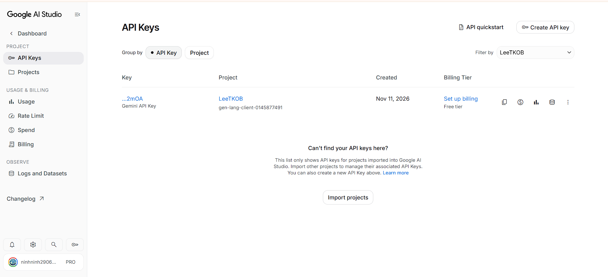

# Free-tier account evidence

- Status: **screenshot supplied and visually reviewed**, 2026-11-11.
- Source: the team's Google AI Studio API Keys screenshot, reproduced below.

## What the screenshot shows

- The selected project is **LeeTKOB**.
- An API key entry exists, with creation date **Nov 11, 2026**.
- The **Billing Tier** column displays **Free tier** and a **Set up billing** action.
- The key is shown only as a shortened suffix; the full credential is not visible. No full API key is included in this repository evidence.

[Open the original screenshot](gemini-free-tier.png)

## Scope and limits

This image supports the team's declaration that its project currently uses the free tier. It does **not** display numerical quotas, a configured monetary spending cap, or an enforcement test. It is not proof that every service or account has billing disabled. No separate quota/billing screenshot has been supplied.

The team may change plans later if necessary. Any move to paid usage must be documented with the actual controls selected at that time. The team's proposed self-assessment remains **100/100**; acceptance of these free-plan controls under the rubric's spending-cap criterion is the lecturer's decision.
