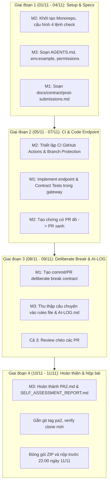

Dựa trên phản hồi của bạn và yêu cầu của Rubric PA#2, dưới đây là **bản phân chia công việc chi tiết cho 3 thành viên** (Phạm An Ninh, Huỳnh Đăng Khoa, Nguyễn Nhật Duy).

Kế hoạch này phân bổ đều khối lượng (100 điểm rubric chia thành 3 mảng: **API & Test**, **DevOps & CI Gate**, **AI Harness & Governance**), đảm bảo mỗi bạn đều phụ trách các tiêu chí cốt lõi và có sản phẩm bàn giao (deliverables) rõ ràng.

---

## TỔNG QUAN PHÂN CHIA (100 ĐIỂM)

| Vai trò | Thành viên phụ trách | Phụ trách tiêu chí Rubric | Điểm | Trọng tâm công việc |
|:---|:---|:---:|:---:|:---|
| **M1: Backend & Contract** | *(Gán cho 1 bạn)* | **Tiêu chí 5 & 6** | **40đ** | Viết file Contract endpoint, code API mẫu và bộ Contract Tests "biết cắn", tạo bằng chứng làm gãy contract. |
| **M2: DevOps & Quality Gate** | *(Gán cho 1 bạn)* | **Tiêu chí 3 & 4** | **30đ** | Khung Monorepo, 1 lệnh cho mọi check (lint/format/typecheck/test), GitHub Actions CI, Branch Protection, bằng chứng PR đỏ → xanh. |
| **M3: AI Harness & Governance** | *(Gán cho 1 bạn)* | **Tiêu chí 1, 2, 7 & Delivery** | **30đ** | File `AGENTS.md` / `CLAUDE.md`, phân quyền 3 tầng, bảo mật secrets / `.env.example`, `AI-LOG.md`, `PA2.md`, `SELF_ASSESSMENT_REPORT.md`. |

---

## CHI TIẾT CÔNG VIỆC TỪNG THÀNH VIÊN

---

### Thành viên 1 (M1): Backend & Contract Tests (40 điểm)
> **Mục tiêu:** Đảm bảo một người lạ chỉ cần đọc file contract là có thể code được client; và bộ test sẽ "cắn" (báo lỗi) ngay nếu code đi lệch contract.

* **Task 1.1: Soạn thảo Contract endpoint (Tiêu chí 5 - 25 điểm)**
  - Tạo file: `docs/contract/post-submissions.md` cho endpoint: `POST /labs/{labId}/submissions`.
  - Quy định rõ **Vai trò & Ownership**: Sinh viên đăng nhập, và **phải thuộc lớp chứa `labId`** đó (không được nộp cho lớp khác).
  - Quy cách Request/Response: Code size $\le$ 64KB, file extension `.cpp`, header `Idempotency-Key` (UUID).
  - Chuẩn hóa toàn bộ lỗi theo **RFC 9457 (Problem Details)**:
    - `400 Bad Request`: Code rỗng, vượt quá 64KB, sai định dạng.
    - `401 Unauthorized`: Chưa đăng nhập hoặc token hết hạn.
    - `403 Forbidden`: Sinh viên không thuộc lớp học này.
    - `404 Not Found`: `labId` không tồn tại.
    - `409 Conflict`: Lab đã quá hạn nộp (deadline), hoặc vi phạm idempotency payload khác nhau với cùng 1 key.
    - `422 Unprocessable Content`: Trùng lặp submit đang xử lý.
  - Mô tả cơ chế Idempotency: Gửi lại cùng `Idempotency-Key` và cùng body thì trả lại kết quả cũ, không tạo 2 bài nộp.

* **Task 1.2: Triển khai code endpoint & Contract Tests (Tiêu chí 6 - 15 điểm)**
  - Viết code xử lý endpoint `POST /labs/{labId}/submissions` trong service `gateway` (NestJS).
  - Viết bộ contract test bao phủ:
    - Test thành công (201 Created) kèm kiểm tra Idempotency khi gửi lại.
    - Test lỗi Ownership (dùng token sinh viên lớp B nộp vào lab lớp A -> phải trả về đúng RFC 9457 403 Forbidden).
    - Test đầy đủ các mã lỗi RFC 9457 đã liệt kê.
  - **Tạo bằng chứng "Deliberate contract break":**
    - Cố tình tạo 1 commit hoặc branch làm sai lệch contract (ví dụ: đổi mã lỗi 403 thành 400, hoặc bỏ trường `detail` trong RFC 9457) để CI chạy contract test báo đỏ.
    - Lưu lại link commit/PR lỗi này để đưa vào `PA2.md`.

---

### Thành viên 2 (M2): DevOps, CI/CD & Branch Protection (30 điểm)
> **Mục tiêu:** Thiết lập hệ thống kiểm tra tự động mà một lệnh chạy ở local cũng giống hệt trên GitHub Actions, và `main` được bảo vệ tuyệt đối.

* **Task 2.1: Khởi tạo khung Monorepo & Một lệnh cho mọi check (Tiêu chí 3 - 10 điểm)**
  - Thiết lập cấu trúc thư mục Monorepo trong repo `LeeTKOB_AWAD`:
    ```text
    LeeTKOB_AWAD/
    ├── .github/workflows/ci.yml
    ├── docs/contract/
    ├── gateway/          (NestJS - phục vụ contract PA#2)
    ├── judge/            (khung Java)
    ├── checker/          (khung Python)
    ├── web/              (khung React)
    ├── package.json      (root quản lý scripts)
    ├── AGENTS.md / CLAUDE.md
    └── README.md
    ```
  - Thiết lập đúng **4 lệnh duy nhất** ở root (ghi rõ trong README):
    - `npm run lint`
    - `npm run format:check`
    - `npm run typecheck`
    - `npm run test` (chạy cả unit tests và contract tests của M1)
  - Đảm bảo khi một người clone mới về, cài đặt theo README và chạy 4 lệnh trên đều ra kết quả xanh (pass).

* **Task 2.2: Thiết lập CI & Branch Protection (Tiêu chí 4 - 20 điểm)**
  - Viết file `.github/workflows/ci.yml` kích hoạt khi có Pull Request vào branch `main`.
  - CI phải chạy đúng 4 lệnh ở Task 2.1.
  - Cấu hình **Branch Protection Rules** trên GitHub repo cho branch `main`:
    - Require status checks to pass before merging (chọn các job lint, format, typecheck, test).
    - Require pull request reviews before merging.
    - Chụp lại màn hình cấu hình này (để M3 gắn vào `PA2.md`).
  - **Tạo bằng chứng CI "Bites":**
    - Tạo 1 Pull Request cố tình vi phạm (ví dụ vi phạm linter hoặc type check) để GitHub chặn nút Merge (hiện trạng thái đỏ). -> *Lưu lại link PR*.
    - Push commit sửa lỗi lên branch đó để CI chuyển sang xanh hoàn toàn. -> *Lưu lại link commit/PR đã xanh*.

---

### Thành viên 3 (M3): AI Harness, Security & Governance (30 điểm)
> **Mục tiêu:** Thiết lập rào chắn cho các trợ lý AI (quy tắc, quyền hạn, bảo mật secrets) và hoàn thiện hồ sơ nghiệm thu PA#2.

* **Task 3.1: Soạn Rules file cho AI (Tiêu chí 1 - 15 điểm)**
  - Tạo `AGENTS.md` và `CLAUDE.md` ở root với đủ 4 mục chuẩn:
    1. `Stack`: React, NestJS, Java Spring Boot, Python, PostgreSQL, Redis, RabbitMQ.
    2. `Commands`: 4 lệnh chuẩn ở Task 2.1.
    3. `Conventions`: Quy ước code, git commit, PR, ghi nhật ký AI.
    4. `Never` (đặc thù riêng của LeeTKOB): Cấm secret/API key trong sandbox, cấm gọi LLM thật trong unit/contract test, cấm sửa test/eval data/label để làm xanh CI, cấm nộp bài thay sinh viên khác,...
  - **Bắt buộc:** Đưa vào **ít nhất 2 dòng quy tắc có câu chuyện thực tế** truy vết được từ commit hoặc `AI-LOG.md` (ví dụ: AI từng tự ý sửa file test khi test fail, hoặc AI hardcode mock token).

* **Task 3.2: Permissions & Secrets (Tiêu chí 2 - 10 điểm)**
  - Viết rõ quyền của trợ lý AI chia thành 3 tầng (ghi trong rules file):
    - `Allowed`: Đọc code, tra cứu tài liệu, format code, chạy test local.
    - `Ask first`: Sửa đổi API contract, thay đổi schema database, sửa cấu hình CI/CD.
    - `Never`: Commit secrets/tokens, sửa code test để pass CI, push trực tiếp lên branch `main`.
  - Tạo file `.env.example` liệt kê đầy đủ các biến môi trường cần thiết (không có giá trị thật).
  - Rà soát toàn bộ lịch sử git: đảm bảo **0 secret / API key**.
  - Cập nhật `README.md`: ghi rõ API key của LLM (Gemini 3.1 Flash-Lite) có **hạn mức chi tiêu (spending cap) là $10**.

* **Task 3.3: Tổng hợp báo cáo nghiệm thu & Đóng gói (Tiêu chí 7 & Deliverables)**
  - Quản lý và chuẩn hóa file `AI-LOG.md` (Tiêu chí 7 - 5đ): đảm bảo ghi nhận các mục `Tool`, `Asked for`, `Kept`, `Changed`, và đặc biệt là các ca `Rejected` thực tế của cả 3 bạn trong quá trình làm.
  - Soạn file `PA2.md` tổng hợp đầy đủ các link:
    - Link repo public.
    - Ảnh screenshot cài đặt Branch Protection.
    - Link PR bị CI đỏ chặn + Commit/PR sửa xanh (từ M2).
    - Link commit/PR deliberate contract break (từ M1).
    - Link CI run của tag `pa2`.
  - Soạn file `SELF_ASSESSMENT_REPORT.md` (tự chấm 100/100 kèm dẫn chứng tương ứng cho 7 tiêu chí).
  - Hướng dẫn nhóm gắn tag git `pa2` và đóng gói file zip: `<MSSV1>-<MSSV2>-<MSSV3>_100.zip`.

---

## TIMELINE ĐỀ XUẤT (TỪ 01/11 ĐẾN 11/11/2026)



Nhóm có thể dựa vào sở trường của 3 bạn (An Ninh, Đăng Khoa, Nhật Duy) để gán vào các vai trò **M1**, **M2**, **M3** cho phù hợp. Bạn thấy bản phân chia này đã hợp lý và cân bằng chưa? Nếu cần điều chỉnh phần nào, bạn cứ báo nhé!